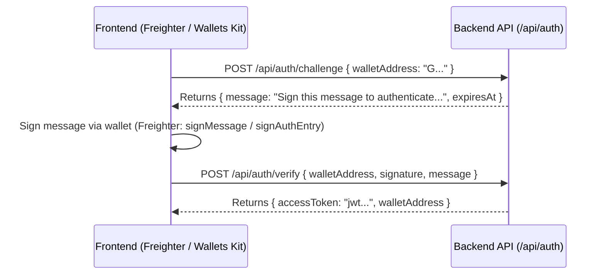

# SaveCircle MVP — Frontend & Backend Integration Handshake

> **Document Version**: 1.0.0  
> **Target Audience**: Frontend Developer & UI/UX Integration Engineer  
> **Backend Base URL (Local)**: `http://localhost:4000/api`  
> **Interactive Swagger OpenAPI**: `http://localhost:4000/docs`  
> **Stellar Network**: Stellar Testnet  

---

## 1. On-Chain Smart Contract Parameters (Stellar Testnet)

The Soroban smart contract is compiled, verified across all 18 test scenarios, and deployed to Stellar Testnet:

| Parameter | Value | Verification Link |
| :--- | :--- | :--- |
| **SaveCircle Contract ID** | `CDSNM3LJEEDHPHKQBEUA5FS42SUMAWTEEKWHAIVWJYYYT6QY3B5HNYNB` | [View in Stellar Lab](https://lab.stellar.org/r/testnet/contract/CDSNM3LJEEDHPHKQBEUA5FS42SUMAWTEEKWHAIVWJYYYT6QY3B5HNYNB) |
| **WASM Hash** | `8dd3e801c3c35b1ceaf62965764f045456cabe6334a6c8106ad75118e984af6f` | [View Upload Tx](https://stellar.expert/explorer/testnet/tx/b0aad55980d98175d6b071caf599306107c6c1f7958439bbd8e67fa2aac5d0e7) |
| **Deploy Tx Hash** | `9be507afc5f7454ebb51f333462993876c1ba9908ec989ce72cf577a3f0f5564` | [View Deploy Tx](https://stellar.expert/explorer/testnet/tx/9be507afc5f7454ebb51f333462993876c1ba9908ec989ce72cf577a3f0f5564) |
| **Contract Admin** | `GCPZAXFI45FYYEG25SDJYI7EP7PR67EV2M24CGT6KJOHUBSEEYF5E36M` | Testnet Friendbot Funded |
| **USDC Token Contract (SAC)** | `CBIELTK6YBZJU5UP2WWQEUCYKLPU6AUNZ2BQ4WWFEIE3USCIHMXQDAMA` | Testnet USDC Asset |
| **Soroban RPC URL** | `https://soroban-testnet.stellar.org` | Standard Testnet Horizon / RPC |
| **Network Passphrase** | `Test SDF Network ; September 2015` | Testnet Passphrase |

---

## 2. Authentication Flow (SEP-0010 Style Challenge/Verify)

SaveCircle does **never** store private keys. Authentication is performed via cryptographic challenge-response:



### Authenticated Requests
Pass the JWT token in all authenticated HTTP calls:
```http
Authorization: Bearer <accessToken>
```

---

## 3. Core REST API Endpoints

### 3.1 Authentication
- `POST /api/auth/challenge`
  - Body: `{ "walletAddress": "G..." }`
  - Response: `{ "message": "Sign this message to authenticate with SaveCircle: <nonce>", "expiresAt": 1732124500000 }`
- `POST /api/auth/verify`
  - Body: `{ "walletAddress": "G...", "signature": "<base64>", "message": "<message>" }`
  - Response: `{ "accessToken": "...", "walletAddress": "G..." }`

### 3.2 Savings Circles (`/api/groups`)
- `POST /api/groups` *(Auth Required)*
  - Body:
    ```json
    {
      "name": "Lagos Tech Ajo",
      "description": "Monthly rotational savings for 5 developers",
      "contributionAmount": "100.00",
      "totalMembers": 5,
      "paymentFrequency": "MONTHLY",
      "cycleDurationDays": 30,
      "approvalThreshold": 3,
      "payoutModel": "ROTATING",
      "rules": "1. Must fund by the 1st. 2. Payout order is immutable.",
      "onChainGroupId": 1
    }
    ```
- `GET /api/groups/my-circles` *(Auth Required)*
  - Returns array of groups where the authenticated user is either the organizer or a member.
- `GET /api/groups/:id`
  - Returns complete group view including members, rotation positions, cycle statuses, and withdrawal proposals.
- `GET /api/groups/invite/:token`
  - Public endpoint to load invitation landing preview.
- `POST /api/groups/join` *(Auth Required)*
  - Body: `{ "inviteToken": "uuid", "displayName": "Tunde", "rotationPosition": 2 }`
- `POST /api/groups/:id/accept-rules` *(Auth Required)*
  - Confirms rule acceptance for the logged-in member.

### 3.3 Contribution Schedules (`/api/schedules`)
- `GET /api/schedules/group/:groupId`
  - Returns chronological list of all cycles, target pool amounts, collected amounts, statuses (`UPCOMING`, `PENDING`, `FUNDED`, `PAID`, `OVERDUE`), due dates, and assigned recipient.
- `GET /api/schedules/my-obligations` *(Auth Required)*
  - Returns all unpaid upcoming and overdue cycles across all groups for the member.

### 3.4 Member & Group Ledger (`/api/ledger`)
- `GET /api/ledger/group/:groupId/my-ledger` *(Auth Required)*
  - Returns member-specific accounting:
    ```json
    {
      "groupId": "...",
      "groupName": "Lagos Tech Ajo",
      "walletAddress": "G...",
      "payoutPosition": 1,
      "totalContributed": "100.00",
      "totalPayoutsReceived": "500.00",
      "outstandingBalance": "400.00",
      "nextPaymentDeadline": "2026-12-20T00:00:00.000Z",
      "cycles": [
        { "cycleIndex": 1, "expectedAmount": "100.00", "paidAmount": "100.00", "status": "COMPLETED", "txHash": "..." },
        { "cycleIndex": 2, "expectedAmount": "100.00", "paidAmount": "0.00", "status": "PENDING" }
      ]
    }
    ```
- `GET /api/ledger/group/:groupId/summary`
  - Returns aggregate group financial state (`totalTargetPool`, `totalCollected`, `totalPayoutsDisbursed`, `availableBalance`, member statuses).

### 3.5 Blockchain & Explorer Helpers (`/api/blockchain`)
- `GET /api/blockchain/config`
  - Returns current on-chain contract addresses and RPC URLs.
- `GET /api/blockchain/tx/:hash`
  - Checks confirmed status of an on-chain transaction hash.

### 3.6 System Health & Monitoring (`/health`)
- `GET /health` *(Public, No Auth Required)*
  - Render cloud health check endpoint verifying process uptime, database connectivity, and on-chain configuration.
  - Sample Response:
    ```json
    {
      "status": "ok",
      "service": "savecircle-backend",
      "timestamp": "2026-11-21T21:20:00.000Z",
      "uptimeSeconds": 120,
      "database": "healthy",
      "stellar": {
        "network": "TESTNET",
        "contractId": "CDSNM3LJEEDHPHKQBEUA5FS42SUMAWTEEKWHAIVWJYYYT6QY3B5HNYNB",
        "usdcToken": "CBIELTK6YBZJU5UP2WWQEUCYKLPU6AUNZ2BQ4WWFEIE3USCIHMXQDAMA"
      }
    }
    ```

---

## 4. Soroban Client Contract Invocation Guide

The Frontend interacts directly with the Soroban contract for all value-bearing transactions.

### 4.1 Required Contract Methods:

```typescript
// 1. Contribute USDC to Cycle
contract.contribute({
  member: userAddress,
  group_id: 1,
  cycle_index: 1,
  amount: 100000000n, // 100 USDC (7 decimals)
});

// 2. Execute Payout for Funded Cycle
contract.execute_payout({
  caller: userAddress,
  group_id: 1,
  cycle_index: 1,
});

// 3. Request Protected Withdrawal
contract.request_withdrawal({
  requester: userAddress,
  group_id: 1,
  amount: 50000000n, // 50 USDC
  recipient: recipientAddress,
});

// 4. Approve Withdrawal
contract.approve_withdrawal({
  approver: userAddress,
  group_id: 1,
  request_id: 1,
});

// 5. Execute Withdrawal
contract.execute_withdrawal({
  caller: userAddress,
  group_id: 1,
  request_id: 1,
});
```
