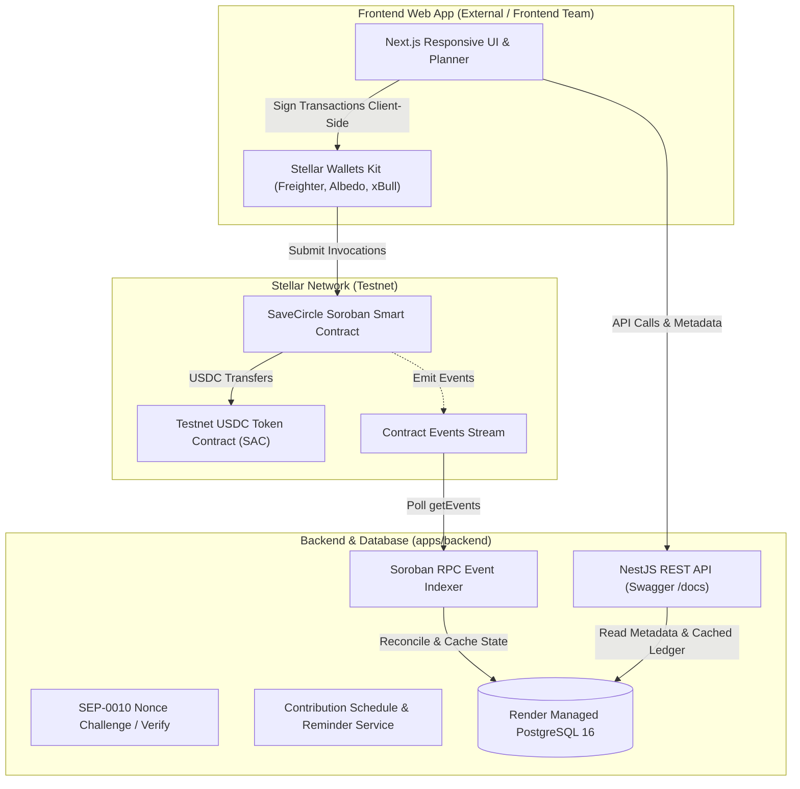

# SaveCircle MVP

> **Decentralized Group Savings, Contribution Scheduling & Rotating Payouts on Stellar**

SaveCircle digitizes traditional group savings (*Ajo*, *Esusu*, *Adashi*) by combining an automated onboarding and contribution scheduling service with a **Soroban-powered smart contract on Stellar Testnet**.

---

## 1. System Architecture



---

## 2. On-Chain Smart Contract Details (Stellar Testnet)

| Parameter | Value | Verification Link |
| :--- | :--- | :--- |
| **Contract ID** | `CDSNM3LJEEDHPHKQBEUA5FS42SUMAWTEEKWHAIVWJYYYT6QY3B5HNYNB` | [View in Stellar Lab](https://lab.stellar.org/r/testnet/contract/CDSNM3LJEEDHPHKQBEUA5FS42SUMAWTEEKWHAIVWJYYYT6QY3B5HNYNB) |
| **WASM Hash** | `8dd3e801c3c35b1ceaf62965764f045456cabe6334a6c8106ad75118e984af6f` | Target wasm32v1-none |
| **Admin Wallet** | `GCPZAXFI45FYYEG25SDJYI7EP7PR67EV2M24CGT6KJOHUBSEEYF5E36M` | Testnet Friendbot Funded |
| **Testnet USDC SAC** | `CBIELTK6YBZJU5UP2WWQEUCYKLPU6AUNZ2BQ4WWFEIE3USCIHMXQDAMA` | Testnet USDC Asset |
| **Deploy Tx** | `9be507afc5f7454ebb51f333462993876c1ba9908ec989ce72cf577a3f0f5564` | [View on Stellar Expert](https://stellar.expert/explorer/testnet/tx/9be507afc5f7454ebb51f333462993876c1ba9908ec989ce72cf577a3f0f5564) |
| **Init Tx** | `5b9a126d724729e5da839b9f716bff4c4221387b8ffc2f32b3a2168fc7c68c67` | [View on Stellar Expert](https://stellar.expert/explorer/testnet/tx/5b9a126d724729e5da839b9f716bff4c4221387b8ffc2f32b3a2168fc7c68c67) |
| **Live Create Group Tx** | `333624b8c4daabc6b9c8010586248d995669d29c5ac710ff368db1f58c107b09` | [View on Stellar Expert](https://stellar.expert/explorer/testnet/tx/333624b8c4daabc6b9c8010586248d995669d29c5ac710ff368db1f58c107b09) |

---

## 3. Monorepo Structure

```
savecircle/
├── contracts/
│   └── group-savings/             # Soroban Rust smart contract
│       ├── Cargo.toml
│       └── src/
│           ├── lib.rs             # Contract entrypoints & logic
│           ├── types.rs           # Storage keys & data structures
│           ├── errors.rs          # ContractError enum
│           ├── events.rs          # Contract event emission helpers
│           └── test.rs            # All 18 PRD test scenarios (100% passing)
├── apps/
│   └── backend/                   # NestJS REST API & RPC Event Indexer
│       ├── prisma/
│       │   └── schema.prisma      # PostgreSQL schema
│       └── src/
│           ├── auth/              # SEP-0010 wallet challenge/verify
│           ├── groups/            # Group creation, invites, rules
│           ├── schedules/         # Contribution & payment schedules
│           ├── ledger/            # Financial reporting & member balances
│           ├── blockchain/        # Soroban RPC client & tx verifier
│           ├── indexer/           # Background Soroban RPC event indexer
│           └── notifications/     # In-app reminders and alerts
├── packages/
│   └── shared/                    # Shared TypeScript types, enums, DTOs
├── render.yaml                    # Render Blueprint (Web service + PostgreSQL)
├── HANDSHAKE.md                   # Integration guide for the Frontend team
├── TECHNICAL_REPORT.md            # On-chain testnet evidence & test matrix
├── todo.md                        # Task checklist
└── README.md                      # This documentation
```

---

## 4. Developer Quickstart

### Prerequisites
- Node.js v20+ / npm v10+
- Rust & Cargo (1.98+)
- `stellar` CLI (28.1+)

### 1. Smart Contract: Test & Build
```bash
# Run all 18 automated PRD test scenarios
npm run contract:test

# Build optimized WASM binary
npm run contract:build
```

### 2. Backend API: Setup & Run
```bash
# Install workspace dependencies
npm install

# Build shared types package
npm --prefix packages/shared run build

# Generate Prisma Client
npm --prefix apps/backend run prisma:generate

# Run backend development server (Swagger at http://localhost:4000/docs)
npm run backend:dev

# Run production boot smoke test
npm --prefix apps/backend run test:smoke
```

---

## 5. Deployment on Render

This repository includes a production-ready `render.yaml` Blueprint:
1. Connect your GitHub repository to **Render**.
2. Click **New +** $\rightarrow$ **Blueprint**.
3. Select this repository; Render will automatically provision:
   - **Render Managed PostgreSQL 16** (`savecircle-db`)
   - **Node.js Web Service** (`savecircle-backend`) running `npx prisma db push --accept-data-loss && node dist/main` with automatic health checks at `/api/blockchain/config`.

---

## 6. Frontend Handshake

The frontend team should refer to **[HANDSHAKE.md](./HANDSHAKE.md)** for:
- Complete REST API documentation and example JSON payloads.
- Wallet signing flows (SEP-0010 challenge-response).
- Soroban contract invocation interfaces and parameters.
- Swagger interactive documentation at `/docs`.
